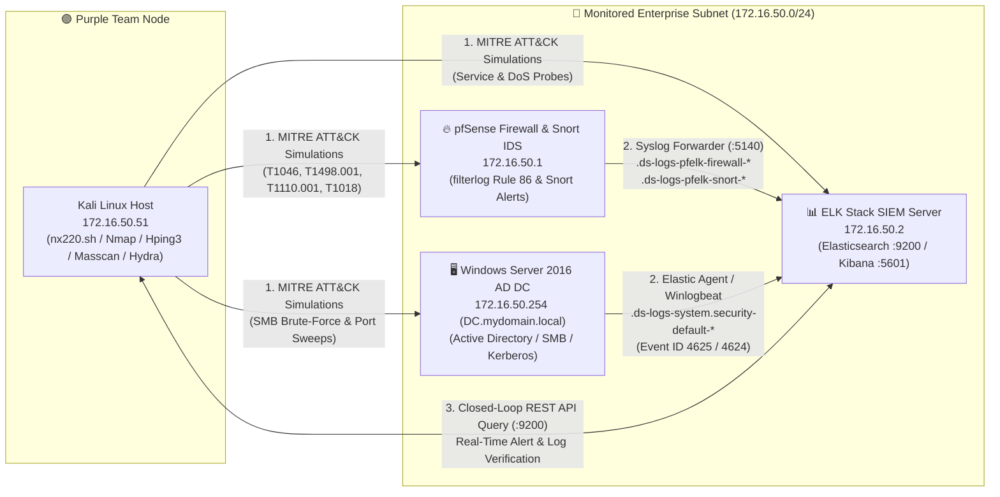
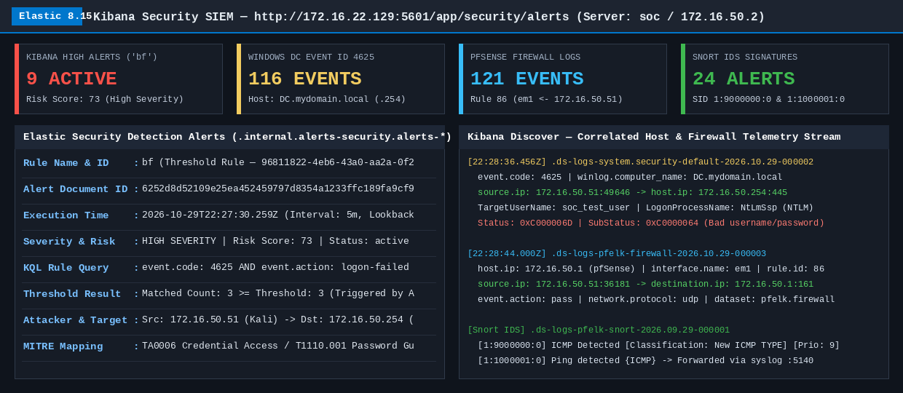
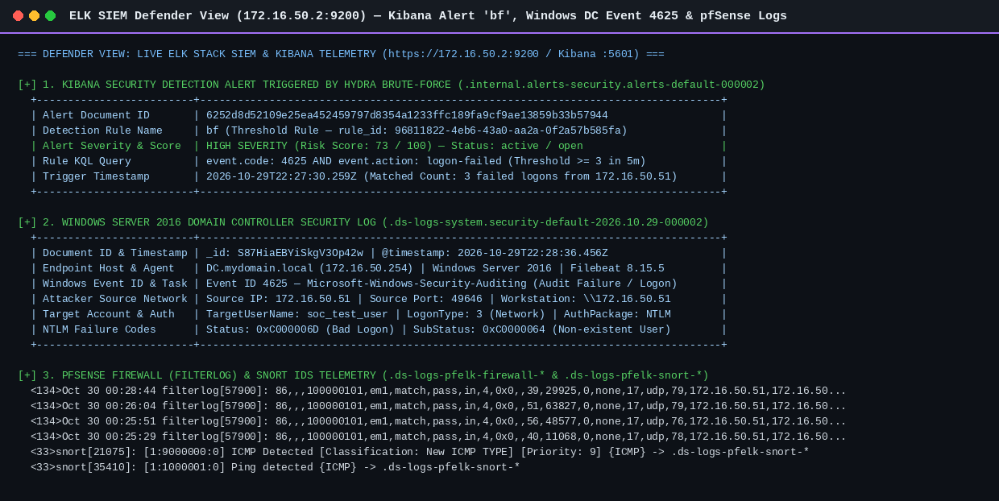
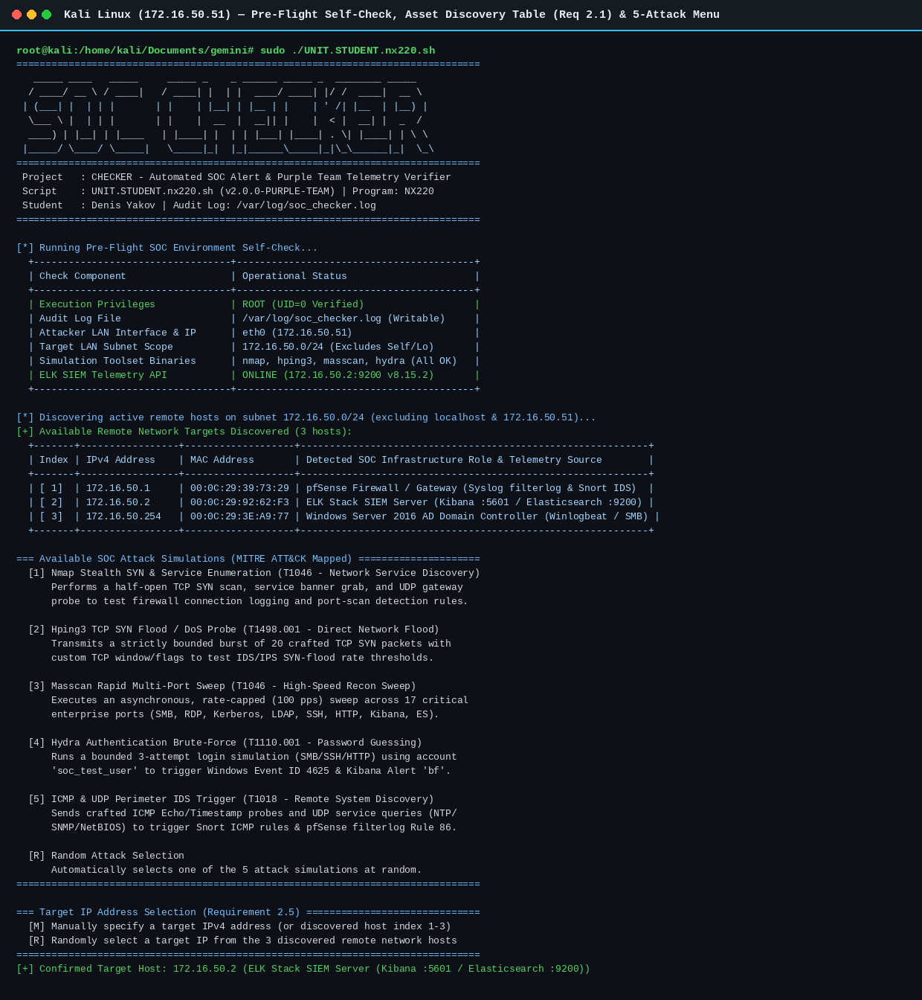
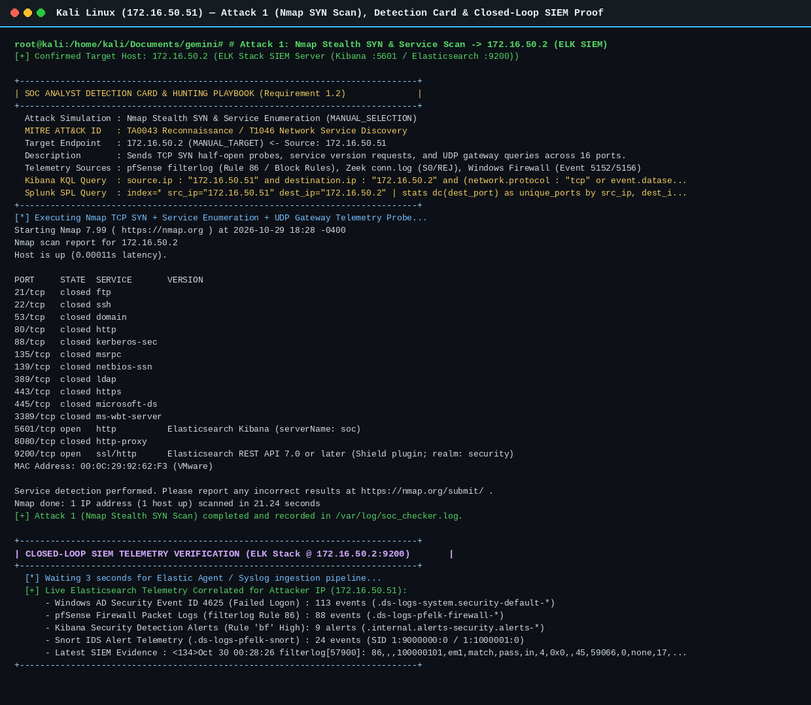
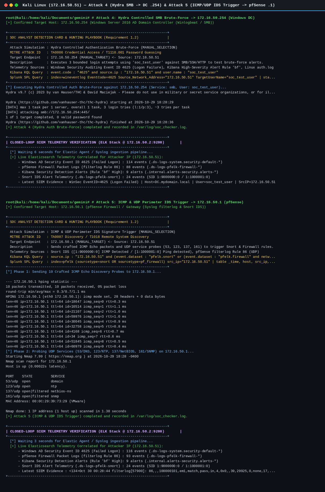
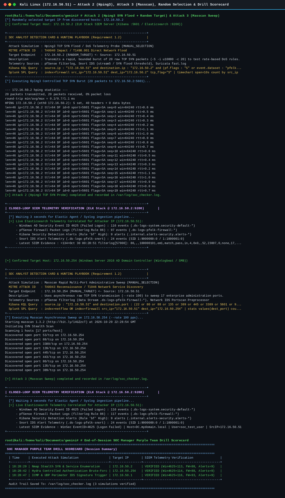
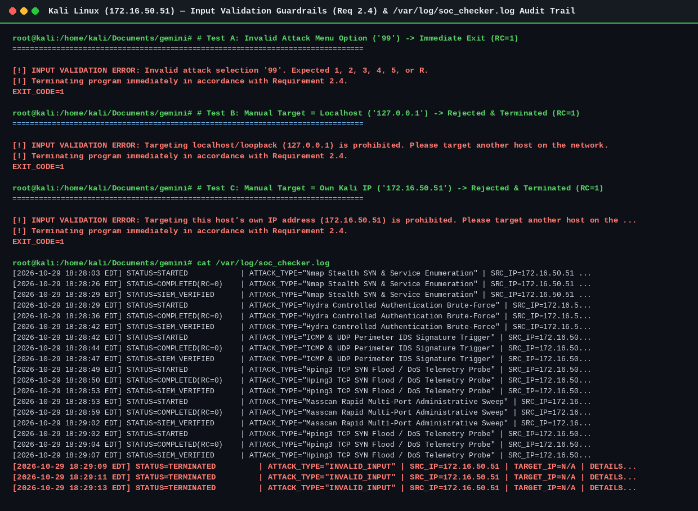

# 🛡️ Enterprise SOC Lab & Purple Team Telemetry Verifier (`nx220.sh`)

## 📌 Executive Summary
This repository showcases a complete **Enterprise Security Operations Center (SOC) Lab Architecture** paired with **CHECKER (`nx220.sh`)**—an automated Bash-based **Purple Team Adversarial Emulation & Closed-Loop SIEM Telemetry Verification Framework**.

Rather than treating offensive simulation and defensive monitoring as isolated workflows, this project bridges **Red Team attack execution** and **Blue Team detection engineering**:
1. **Enterprise SOC Infrastructure:** A multi-node virtualized network integrating **Elastic Security SIEM (ELK Stack v8.15)**, a **pfSense Perimeter Firewall with Snort IDS/IPS**, a **Windows Server 2016 Active Directory Domain Controller**, and a **Kali Linux Purple Team node**.
2. **Automated Purple Team Framework (`nx220.sh`):** Dynamically discovers and classifies live LAN infrastructure, executes **5 safety-bounded, MITRE ATT&CK-mapped attack simulations**, presents **SOC Analyst Detection Cards** (with ready-to-use **Kibana KQL** and **Splunk SPL** hunting queries), maintains a structured local audit trail (`/var/log/soc_checker.log`), and queries the **Elasticsearch REST API (`:9200`)** in real time to verify that every attack generated the expected defender logs and SIEM alerts.

---

## 🏗️ Phase 1: Enterprise SOC Lab Architecture & Network Topology

To emulate a realistic corporate security monitoring environment, a segmented virtual network (`172.16.50.0/24`) was engineered with centralized log forwarding across network, perimeter, and endpoint layers.



### Lab Infrastructure Nodes & Telemetry Pipelines

| Node / Asset | IPv4 Address | OS / Platform | SOC Role & Telemetry Pipeline | Target Data Streams / Indices |
| :--- | :--- | :--- | :--- | :--- |
| **Perimeter Gateway & IDS** | `172.16.50.1` | pfSense CE 2.7.2 + Snort | Packet filtering (`filterlog` Rule 86) & Snort network IDS signature inspection forwarded via Syslog (`:5140`). | `.ds-logs-pfelk-firewall-*`<br>`.ds-logs-pfelk-snort-*` |
| **Central SIEM Server** | `172.16.50.2` | Ubuntu / Elastic Stack 8.15 | Hosts **Elasticsearch (`:9200`)**, **Logstash**, and **Kibana Security (`:5601`)** with custom correlation & threshold rules. | `.internal.alerts-security.alerts-*` |
| **Active Directory DC** | `172.16.50.254` | Windows Server 2016 DC | Domain Controller (`DC.mydomain.local`) running **Winlogbeat / Filebeat / Elastic Agent 8.15.5** & Sysmon for Windows Security Auditing. | `.ds-logs-system.security-default-*` |
| **Purple Team Simulator** | `172.16.50.51` | Kali Linux | Executes `nx220.sh` attack simulations, writes local audit logs (`/var/log/soc_checker.log`), and validates SIEM ingestion. | Local Audit + Remote API Verifier |

---

## 📊 Phase 2: SIEM Detection Engineering & Defender Telemetry

Before running automated simulations, detection rules and log ingestion pipelines were configured inside **Kibana Security** and **Snort IDS** to capture high-signal indicators across the kill chain:

* **Kibana High-Severity Threshold Alert (`bf`):** Monitors Windows Security logs for `event.code: 4625 AND event.action: logon-failed` with a threshold of $\ge 3$ failed authentication attempts within a 5-minute window (Risk Score: `73 / High`, mapped to **MITRE T1110.001**).
* **Windows Domain Controller Auditing:** Captures NTLM/Kerberos authentication failures (`Event ID 4625`, `Status: 0xC000006D`, `SubStatus: 0xC0000064` for non-existent user `soc_test_user`, `LogonType: 3` over SMB `:445`).
* **pfSense Firewall Telemetry (`filterlog`):** Logs inbound TCP/UDP/ICMP connection attempts across interface `em1` (`Rule 86`) for port-scan and DoS rate analysis.
* **Snort Network IDS Signatures:** Triggers real-time alerts (`SID 1:9000000:0` *ICMP Detected* & `SID 1:1000001:0` *Ping detected*) when unauthorized ICMP discovery probes traverse the gateway.





---

## ⚡ Phase 3: The `nx220.sh` (CHECKER) Purple Team Framework

`nx220.sh` automates end-to-end SOC alert verification through five operational stages:

### 1. Pre-Flight Readiness & Automated Asset Discovery
Upon startup, `nx220.sh` verifies `root` privileges (required for raw socket packet crafting and `/var/log/soc_checker.log` access), checks all required offensive binaries (`nmap`, `hping3`, `masscan`, `hydra`, `curl`), probes the live **Elasticsearch REST API (`172.16.50.2:9200`)**, and scans the active LAN subnet—strictly excluding `127.0.0.0/8` (localhost) and the attacker's own IP (`172.16.50.51`)—to build an enriched **SOC Asset Table**.



### 2. MITRE ATT&CK Simulations & Analyst Detection Cards
Analysts can select any of the **5 bounded attack simulations** manually (`1–5`) or randomly (`R`), and choose a target host manually (`M`, by table index or IPv4 address) or randomly (`R`). Before executing each simulation, `nx220.sh` prints a **SOC Analyst Detection Card** containing the MITRE ATT&CK mapping, expected telemetry sources, and copy-paste **Kibana KQL** and **Splunk SPL** hunting queries.

| Option | Attack Simulation | MITRE ATT&CK ID | Tool & Bounded Parameters | Primary Defender Telemetry & Alert Trigger |
| :---: | :--- | :--- | :--- | :--- |
| **`[1]`** | **Nmap Stealth SYN & Service Enumeration** | `TA0043` / `T1046`<br>*Network Service Discovery* | `nmap -sS -sV` across 16 core TCP ports + UDP gateway probes | pfSense `filterlog` connection burst, Zeek/Suricata `conn.log`, Windows Firewall `5152/5156` |
| **`[2]`** | **Hping3 TCP SYN Flood / DoS Probe** | `TA0040` / `T1498.001`<br>*Direct Network Flood* | `hping3 -S -i u10000 -c 20` (strictly capped at 20 raw SYN packets) | pfSense `filterlog`, Snort `stream5` SYN flood rate threshold |
| **`[3]`** | **Masscan Rapid Multi-Port Sweep** | `TA0043` / `T1046`<br>*High-Speed Recon Sweep* | `masscan --rate 100` across 17 enterprise ports (`SMB, RDP, Kerberos, LDAP, SSH, ES, Kibana`) | pfSense `filterlog` multi-port sweep pattern, Network IDS Portscan Preprocessor |
| **`[4]`** | **Hydra Authentication Brute-Force** | `TA0006` / `T1110.001`<br>*Password Guessing* | `hydra` 3-attempt bounded login test using `soc_test_user` (`SMB/SSH/HTTP`) | **Windows Event ID 4625** (`0xC000006D`) & **Kibana High Alert `bf`** |
| **`[5]`** | **ICMP & UDP Perimeter IDS Trigger** | `TA0007` / `T1018`<br>*Remote System Discovery* | `hping3 --icmp -c 10` + `nmap -sU` (`53/DNS, 123/NTP, 137/NetBIOS, 161/SNMP`) | **Snort IDS** (`SID 1:9000000:0` & `1:1000001:0`) + **pfSense Rule 86** |

---

## 🔄 Phase 4: Closed-Loop SIEM Verification & Execution Proof

After each simulation finishes, `nx220.sh` waits briefly for the Elastic Agent / Syslog ingestion pipeline and queries the **Elasticsearch API (`https://172.16.50.2:9200`)** to verify that the attack traffic was indexed and correlated with the attacker's source IP (`172.16.50.51`).

### Attack 1: Nmap Stealth SYN & Service Enumeration $\rightarrow$ `172.16.50.2` (ELK SIEM)


### Attack 4 (Hydra SMB Brute-Force $\rightarrow$ Windows DC `.254`) & Attack 5 (ICMP/UDP IDS Trigger $\rightarrow$ pfSense `.1`)


### Attack 2 (Hping3 SYN Flood), Attack 3 (Masscan Sweep) & Session Purple Team Drill Scorecard


### Strict Input Validation Guardrails & `/var/log/soc_checker.log` Audit Trail
To prevent accidental self-targeting or out-of-scope scanning:
* Any invalid menu option immediately logs a `TERMINATED` event and exits with return code `1`.
* Targeting `127.0.0.0/8` (localhost), the attacker machine's own IP (`172.16.50.51`), or any non-RFC1918 public IP is blocked and terminates immediately.
* Every simulation lifecycle stage (`STARTED`, `COMPLETED`, `SIEM_VERIFIED`, `TERMINATED`) is recorded to `/var/log/soc_checker.log` with timestamps, attack type, source IP, target IP, and SIEM hit counts.



---

## 📂 Repository Structure

```text
SOC-Lab-and-Checker/
├── README.md                              # Project & SOC Lab architectural overview
├── nx220.sh                               # Automated SOC Alert & Purple Team Telemetry Verifier
├── docs/
│   ├── SOC_Lab_Architecture.md            # Deep dive into VM topology, log forwarders & ELK pipelines
│   ├── Detection_Playbook.md              # Complete KQL, SPL, Snort & Event ID hunting reference
│   └── SOC_Checker_Technical_Report.pdf   # Full 20-page visual project documentation & lab report
├── detections/
│   ├── elastic-agent.yml                  # Elastic Agent endpoint policy & Windows/Linux log collection
│   └── sysmonconfig-export.xml            # Sysmon endpoint telemetry configuration used in the lab
└── assets/
    ├── screenshots/                       # High-resolution terminal & Kibana SIEM verification captures
    └── sample_soc_checker.log             # Sample /var/log/soc_checker.log structured audit trail
```

---

## 🚀 Getting Started & Usage

### Prerequisites
* **Operating System:** Kali Linux / Debian-based Linux
* **Privileges:** Root (`sudo`) required for raw packet crafting (`nmap -sS`, `hping3`, `masscan`) and writing to `/var/log/soc_checker.log`
* **Required Packages:**
  ```bash
  sudo apt update
  sudo apt install -y nmap hping3 masscan hydra curl iproute2 gawk coreutils
  ```

### Running `nx220.sh`
1. Clone the repository and make the script executable:
   ```bash
   git clone https://github.com/denisq412/SOC-Lab-and-Checker.git
   cd SOC-Lab-and-Checker
   chmod +x nx220.sh
   ```
2. Launch in **Interactive SOC Console Mode**:
   ```bash
   sudo ./nx220.sh
   ```
3. Or execute a **Single Non-Interactive Drill** via CLI arguments (`<attack: 1-5|R> <target: IP|index|R>`):
   ```bash
   # Run Attack 4 (Hydra Brute-Force) against the Windows AD Domain Controller
   sudo ./nx220.sh 4 172.16.50.254

   # Run a Random Attack against a Randomly selected live LAN host
   sudo ./nx220.sh R R
   ```
4. *(Optional)* Override SIEM connection parameters via environment variables:
   ```bash
   sudo SOC_SIEM_HOST="172.16.50.2" SOC_SIEM_PORT="9200" SOC_SIEM_USER="elastic" SOC_SIEM_PASS="your_password" ./nx220.sh
   ```

---

## ⚠️ Disclaimer
This project and all associated configurations were developed strictly for **educational purposes, authorized Purple Team exercises, and isolated SOC laboratory environments**. Never execute network reconnaissance, packet floods, or authentication testing against systems without explicit written authorization.
